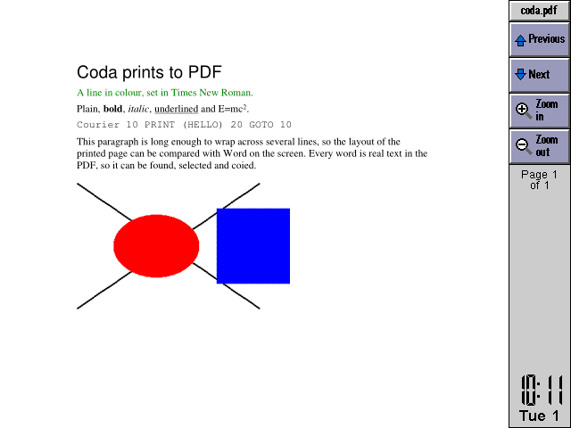
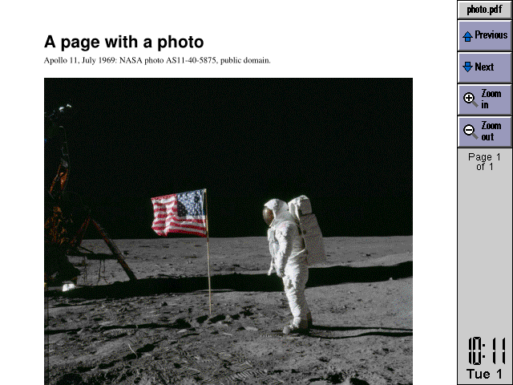
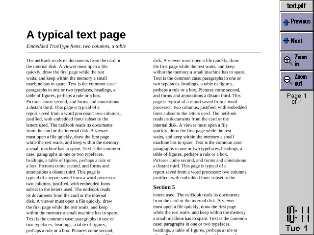
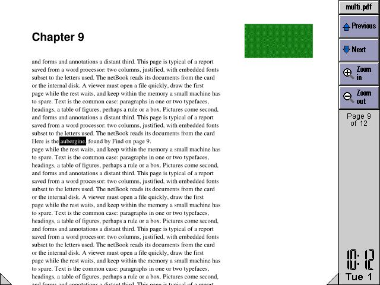
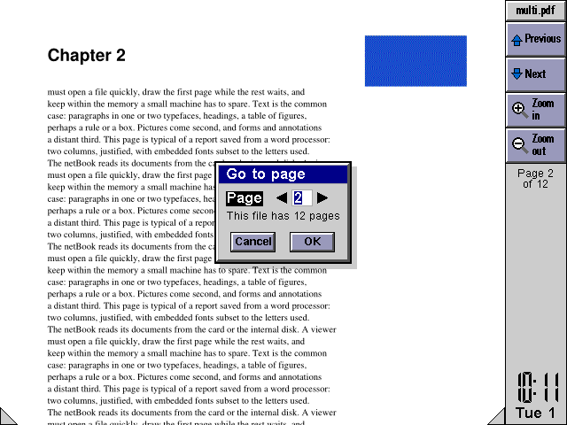
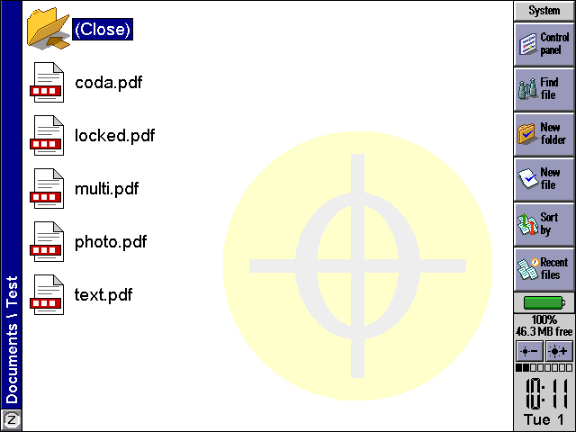
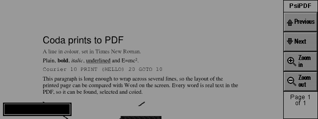

# PsiPDF

PDF files on the **Psion netBook** and the **Psion Series 5mx** (EPOC Release 5), drawn by [MuPDF](https://mupdf.com/). Version 0.11.

PsiPDF opens a PDF from the System screen, from PsiHub or with File > Open, and shows its first page (or the page you left it at) fitted to the width of the screen. It draws real PDF files: embedded fonts, the 14 standard fonts, colour, lines and fills, and JPEG photos. On the netBook pages show in EPOC's 256 colours, error-diffused; on the 5mx in 16 greys.



## Contents

- [Using it](#using-it)
- [Installing](#installing)
- [How it works](#how-it-works)
- [What it does not do yet](#what-it-does-not-do-yet)
- [Building](#building)
- [Testing](#testing)
- [Credits](#credits)
- [Licence](#licence)

## Using it

| To | Press | Or |
|---|---|---|
| Open a PDF | Ctrl+O | tap it on the System screen or in PsiHub |
| Next page | Fn+Down (Page down) | Shift+Ctrl+N, the toolbar's Next, the bottom-right dog-ear, Space at the foot of a page, Down at the foot of a page |
| Previous page | Fn+Up (Page up) | Shift+Ctrl+B, the toolbar's Back, the bottom-left dog-ear, Backspace at the head of a page |
| First or last page | Ctrl+Fn+Up, Ctrl+Fn+Down | View > First page, Last page |
| Go to a page | Ctrl+G | Edit > Go to page |
| Zoom in or out | Ctrl+M, Shift+Ctrl+M | the toolbar; a step at a time in order of size (fit page, fit width, 100%, 150%, 200%), stopping at the largest and the smallest ("Largest zoom", "Smallest zoom") |
| Fit the width (a file opens so) | Ctrl+W | View > Zoom to > Fit width |
| Fit the page | Shift+Ctrl+W | View > Zoom to > Fit page |
| Move round the page | the arrow keys (Ctrl: a screen at a time) | drag with the pen |
| Top or foot of the page | Fn+Left (Home), Fn+Right (End) | |
| Find text | Ctrl+F, then Ctrl+J for the next | Edit > Find, Find next |
| Stop drawing or finding | Esc | the page stays as far as it was drawn; Enter draws it again (and a page not all drawn) |
| Show or hide the toolbar | Ctrl+T | View > Show toolbar |
| File details | Shift+Ctrl+D | File > File details |
| Keep a log | | Tools > Troubleshooting > Keep a log |
| Help | Shift+Ctrl+H | Tools > Help on PsiPDF |
| About PsiPDF | Shift+Ctrl+A | Tools > About PsiPDF |

100% is the page at its real size on the screen in use. On the netBook the toolbar shows the page ("Page 3 of 12") under its buttons, and on Coda's image Coda's battery, gauges and clock below that, as in Psion's own programs; on the 5mx, whose toolbar has room only for the buttons and the clock, and with the toolbar hidden, an infoprint says the page when it changes.

The page appears as it is drawn, from the top down, with "Drawing the page…" bottom left. (0.15) The message is EIKON's busy message, but steady: EIKON's own flashes, and on the netBook, where a zoomed page can take several seconds, it was often caught as an empty dark box. While you read it, PsiPDF draws the next page ahead (when it is fitted to the width or the page, and there is memory to spare), so turning the page is immediate.

Left behind other programs for five minutes with a file open, PsiPDF stops its engine (MuPDF, 3 to 9 MB with its code), keeping the page on the screen; coming back to it opens the file again at the same page and zoom.

PsiPDF remembers the last eight files with their page and zoom, and opens the last file again when started from its icon (`C:\System\Apps\PsiPDF\PsiPDF.ini`), unless its page could not be shown last time (it ran out of memory or stopped the engine): then it waits for Ctrl+O. A file that needs a password asks for it.

A page that cannot be shown says so, in a dialog and in its place on the screen ("Cannot show this page", "Not enough memory to show this page", "This page is too big to show"), never a blank page. A page there was not enough memory for is shown by itself once memory comes back: when Coda's memory service says the Psion is less short, when 1 MB more is free, or when PsiPDF comes back to the front; a tap on the page or Enter tries at once. On Coda the dialog has a Free memory… button, which opens Coda's Free memory (it can put the programs behind to sleep or close them); on a Psion without it the dialog says to close other programs. A page drawn only in part says so in a dialog the first time in a file, then in an infoprint. With Tools > Troubleshooting > Keep a log ticked (or Coda's debug mode on: Control panel > Diagnostics), PsiPDF keeps a log of each session in `C:\System\Apps\PsiPDF\PsiPDF.log` (on the internal disk, wherever PsiPDF is installed), and the session before in `PsiPDF.old`: send both with a report. Without it, no log is written. A session that never showed its page has `engine: started` with no `engine: ready` after it.

| | |
|---|---|
|  |  |
|  |  |
|  |  |

Screenshots from the netBook and Series 5mx emulators, of PsiPDF's own test files.

## Installing

Install `PsiPDF.sis` on the card (D:): copy it to the Psion and tap it on the System screen. It is about 1.7 MB: the program, its engine (1.1 MB), the font file (`PsiPDF.fnt`, 0.3 MB: the 14 standard PDF fonts), the recogniser (so that PDF files open in PsiPDF; it goes on the internal disk, with a spare copy beside the program, from which PsiPDF puts it back if the internal disk has been cleared), and the EPOC C library the engine needs (the 5mx's ROM does not have it). One package serves both machines.

## How it works

PsiPDF is two programs.

- **PsiPDF.app** (`app/`) is the EIKON program: menus, dialogs, the toolbar, keys, the pen and the screen.
- **psipdf.exe** (`engine/`) is MuPDF 1.3, cut down, with PsiPDF's own drawing code (`engine/ppcore.c`) and colour code (`engine/ppquant.c`).

An EPOC R5 program is a DLL, and no DLL may have writable static data; MuPDF, FreeType and libjpeg all have some. An `.exe` may, wherever it is installed, so the engine is one: on the card the whole of it is loaded into RAM when it starts. This also keeps the program responsive (the engine runs below it) and safe (a file that crashes MuPDF ends the engine, not PsiPDF).

The two share a small global chunk (`psipdf.h`): a command at a time, with psion-core's doorbells (`core/ssh/psibell.h`) so that neither looks for work while idle. A page comes back in a bitmap the program makes, in the screen's own format (EColor256 or EGray16), which the engine fills band by band (about 64 rows at a time, so MuPDF's RGBA pixmap is 160 KB rather than 2.3 MB for the whole page). Each page's display list is kept, so a new zoom does not interpret the page again, and Find reads the same list.

Memory. The netBook has about 16 MB free once it has started, for every program, so PsiPDF takes what it needs from what is free when a file opens:
- MuPDF's store (decoded pictures and fonts kept between bands and pages): a fifth of the free memory (0.14; a quarter before), from 1 MB up to 3 MB (2 MB on the 5mx). A picture is decoded no bigger than the store, so with little memory free a photo is a little softer.
- The biggest page bitmap: a fifth of the free memory, from 1 MB up to 6 MB.
- Closing PsiPDF (or its engine stopping behind another program) ends the engine at once: its memory goes back whole as the process ends (0.14). It used to free MuPDF's heap block by block, at a priority below every program's, and on a busy Psion was killed when that took too long. With less memory, 150% and 200% are drawn a little smaller than they say.
- Only one page is decoded at a time: the pictures of the page drawn before are dropped from the store before the next is drawn (a 4-page photo document: its peak in MuPDF was 7.8 MB, now 5.7 MB on the PC).
- Scanned pages (fax or Flate pictures, which MuPDF decodes whole before it reduces them) are decoded a few rows at a time and reduced as they come: a 300 dpi A4 scan took 18.7 MB (1 bit a pixel) or 26 MB (8 bits) at its peak, now about 1 MB.
- The engine may take no more than was free when a page began, less 1 MB for the system and the other programs; past that, MuPDF gives back what it keeps and tries again, or the page says there is not enough memory. A page bitmap is at most 16,384 pixels a side, whatever size the page says it is.
- The engine gives back its heap after each page (EPOC's heap does not shrink by itself), stops after five minutes behind (above), and is ended for certain when PsiPDF closes.
- The 14 standard PDF fonts are not in the engine's code (a program on the card is in memory whole while it runs) but in `PsiPDF.fnt` beside it, in `\System\Apps\PsiPDF\` on the disk PsiPDF is installed on. The engine (`engine/ppfont.c`) reads one font when a PDF asks for it (16 to 30 KB each), shares it between every use in the file, and frees it when MuPDF lets the font go or the file closes. A PDF with its fonts embedded reads none. Helvetica alone (16 KB) stays in the engine: if the font file is missing or damaged the file still opens, text in the standard fonts shows in Helvetica, and PsiPDF says so once ("PsiPDF's font file not found"). The font file is checked as it is read (its length, each font's place and checksum).
- MuPDF's Unicode tables (ucdn, 102 KB) are left out: the one thing used from them, a character's direction class for Find, is a 6 KB table made from them at build time (`tools/mkbidi.c`, `engine/mu/ppbidi.c`), checked against ucdn for every character (`make TARGET=host bidicheck`).
- Short of memory, the program that watches the free memory (psion-core's `ssh/psimem.h`) may ask: "trim" drops the page drawn ahead, the decoded pictures and glyphs kept, and the other pages' display lists; "sleep", behind another program with a file open, stops the engine at once, as after five minutes.

The colours: error diffusion (Floyd-Steinberg, serpentine) to the nearest of EPOC's 256 colours (weighted for the eye, from a 32 x 32 x 32 table made at build time by `tools/mkpal.py`), or to 16 greys on the 5mx. The paper and full black come out exactly and the error arriving there is dropped, so the margins and the space between lines stay plain; the palette's 16 greys are exact steps, so text and its anti-aliased edges stay crisp.

MuPDF 1.3 (August 2013) is the last version that is plain C with no HarfBuzz, which the SDK's gcc 3.0 builds with `-std=gnu99`. The port's shims are in `engine/mu/`: single-precision maths over EPOC's double functions, `float.h`, `snprintf` (psion-core's), and stubs for the parts left out.

Files from anywhere. A PDF can be made to break the program that reads it, and MuPDF 1.3 is old, so (0.08):
- MuPDF runs in the engine, its own process: whatever a file does to it, PsiPDF itself carries on and says the file could not be shown.
- JBIG2, JPEG 2000, PNG and TIFF pictures, JavaScript, XPS and forms are not built in at all.
- Every block MuPDF asks for goes through PsiPDF's counted allocator: a size from the file of more than a gigabyte is refused before anything is added to it (and the file is "damaged"), and the engine's own limit, the memory free when a page began, is compared unsigned. A size near 4 GB used to wrap to a tiny block, and one over 2 GB stopped the engine.
- The picture budget is worked out by division, so a picture of 65536 x 32768 pixels is reduced like any other big one (its size in bytes, 2^32, was kept as 0 and the picture decoded whole).
- Three of MuPDF's files are built from copies with the limits later MuPDF has (`tools/mupatch.py`, applied in `build/gen/mu/`; `third/mupdf` stays as fetched): object numbers up to 8,388,607 in the xref tables and streams, no more objects in an object stream than the file has, at most 32 colours in a mesh shading's `/Decode`, and a sampled function's size checked as it is multiplied.
- MuPDF itself already refuses pictures over 65536 pixels a side or 16 bits a component, and nests no deeper than its 256-level error stack.
- Still exposed: the rest of MuPDF 1.3's PDF parser, its fonts (FreeType 2.4.11, 2012) and libjpeg 9 (2013) parse whatever the file holds, with the faults found in them since 2013 that this list does not name. Moving to a newer MuPDF is the real fix, but the newer ones bring HarfBuzz (above).

## What it does not do yet

- **Not tested:** encrypted files other than 128-bit RC4 (AES, and revisions 5 and 6), Type 3 fonts, shadings (gradients), transparency groups, CMYK and ICC colours, very long documents (hundreds of pages), progressive JPEGs, and any real netBook or 5mx: only the emulators.
- **Encrypted files in the 5mx emulator:** with the emulator's card speed-up on (its standard), opening an encrypted file, and sometimes a second plain one, switches the emulated machine off: the speed-up runs the card driver's code in the middle of a program's own thread. With it off (`PSION_NO_CF_DIRECT_INVOKE=1`, slower) the password is asked for and the page is drawn. Not seen on the netBook; still to be tried on a real 5mx.
- **Big pictures at high zoom:** a picture is decoded no bigger than the picture store holds (up to 2 MB on the 5mx, 3 MB on the netBook; less when little memory is free) and scaled up when drawn bigger, so a full-page photo at 100% or more is decoded once a page rather than at full size for every band (a 1237 x 1280 JPEG: 11.7 MB at its peak before, 3.6 MB now). Very big pictures at 200% are a little softer than their full size. A page that could not all be drawn says so.
- **Left out of the build:** JavaScript, CJK fonts and CMaps (Chinese, Japanese and Korean text shows in a substitute or not at all), forms (filled-in fields show only as the file drew them), saving, JBIG2 and JPEG 2000 pictures (these show as blank, and the page says it could not all be drawn).
- **Not there yet:** links, the outline (bookmarks), text selection and copying, rotating a page, printing.
- **Speed.** The netBook's SA-1100 has no floating point, and MuPDF does much of its work in floats. In the netBook emulator a page fitted to the width takes, the first time: a page from Coda's Print to PDF 1.2 s, a two-column page in embedded fonts 2.0 s, a plain text page 1.3 to 1.8 s, a full-page photo 3.1 s. A zoom of a page already drawn skips the interpretation (a Coda page at 150%: 1.8 s), and the next page is usually ready before you turn to it. On the 5mx (ARM710T at 36 MHz) a Coda page took about 8 s.

## Building

You need Docker and the EPOC R5 C++ SDK, set up by psion-core's build container:

```
git clone --recurse-submodules https://github.com/danieledge/psipdf.git
cd psipdf
export PSION_WORK=$PWD/..          # the folder holding psipdf and psion_cpp_sdk_linux
core/tools/docker/psibuild setup   # once: the image and the SDK
./fetch.sh                         # MuPDF 1.3's source, checked by its SHA-256
core/tools/docker/psibuild "bash build.sh"
python3 pkg/mkicon.py build/pkg core
core/tools/docker/psibuild "bash build.sh sis"   # dist/PsiPDF.sis
```

MuPDF's source is never in this repository: `fetch.sh` downloads the official release (`mupdf-1.3-source.tar.gz` from mupdf.com) and checks its SHA-256 before use. PsiPDF does not change MuPDF's files; it builds the ones it needs (the `Makefile` lists those left out), three of them from patched copies made at build time (`tools/mupatch.py`, above), and adds its own in `engine/`.

`make TARGET=host` builds `build/host/pphost` (and `build/gen/PsiPDF.fnt`), the same engine on a PC: it draws pages exactly as the Psion does, into PPM pictures in the screen's colours, with the times and memory (run it with no arguments for its options).

## Testing

- `test/mkpdfs.py OUTDIR --coda FILE --photo FILE.jpg` makes the test files: a page from Coda's Print to PDF, a two-column text page in embedded TrueType fonts, a photo page, a 12-page document and one with a password ("psion").
- `test/mkbig.py OUTDIR` makes the memory tests: a 300 dpi A4 scan at 1 and 8 bits a pixel, and a page too big for any bitmap. On the PC, `build/host/pphost` prints each page's heap peak (0.06: about 1 MB for the scans, 18.7 and 26 MB before). In the netBook emulator, 0.05 said "Not enough memory" for both scans and 0.06 shows them (`docs/img/2026-11-19-memory/`: the scan and the huge page before and after, and a page stopped with Esc).
- `make TARGET=host hostile` (0.08): `test/alloctest.c` runs the engine's allocator and picture budget with the sizes a hostile file can give (ppcore.c is compiled into it), then `test/hostile.sh` opens the files `test/crafted.py` makes (an object stream of 1,073,741,822 or 600,000,000 objects, xref streams with a huge `/Size` or `/Index`, a 65536 x 32768 picture, a mesh shading with 1000 numbers in `/Decode`, a sampled function whose size wraps) with blocks limited to 16 MB as on the Psion (`pphost -L`). Each ends with an error or a page, never a crash; with 0.07 three of them crashed the engine on the PC, and two more asked for over 2 GB, which stops it on the Psion.
- **netBook emulator:** the emulator does not mount the card, so `test/emu/nbimage.mts` puts PsiPDF in the ROM of a scratch test image with its engine in parts, which a test launcher joins on C: at boot (PsiPDF looks for its engine in `\System\Apps\PsiPDF\` on every disk). `test/emu/run.sh` runs a script of keys and taps (`test/emu/emu.py`) and keeps PsiPDF's log. This needs the Coda image tools.
- **Series 5mx emulator:** `node --experimental-strip-types core/tools/emu/mkcard.ts psipdf` makes a card with PsiPDF installed on it (`test/emu/psipdf.card.ts`); then `core/tools/emu/run.sh`.

## Credits

PsiPDF is by Dan Edge. It is built on:

- **[MuPDF](https://mupdf.com/) 1.3**, by Artifex Software, Inc., under the GNU Affero General Public License 3. MuPDF draws every page.
- **[FreeType](https://www.freetype.org/) 2.4.11** (the FreeType Project, under the FreeType License), **libjpeg 9** (this software is based in part on the work of the Independent JPEG Group) and MuPDF's other bundled code: ucdn, and its AES, MD5, SHA-2 and RC4 code.
- **The URW++ base 35 fonts** (Nimbus Sans L, Nimbus Roman No9 L, Nimbus Mono L, Standard Symbols L, Dingbats), as shipped with MuPDF 1.3, for the 14 standard PDF fonts.
- **[zlib](https://zlib.net/)** by Jean-loup Gailly and Mark Adler, and **[psion-core](https://github.com/danieledge/psion-core)**, the shared code of Dan Edge's Psion programs.

`NOTICE` lists each with its copyright and licence; it is installed with the program as `NOTICE.txt`, beside `LICENSE.txt`.

## Licence

PsiPDF is free software under the **GNU Affero General Public License, version 3 or later** (`LICENSE`), because MuPDF is. Copyright (C) 2026 Dan Edge.

Its complete source, MuPDF's included (fetched by `fetch.sh` at a fixed version and checksum), is at https://github.com/danieledge/psipdf. If you pass PsiPDF on, pass on the source too, or say where it is; the About box (Shift+Ctrl+A) says where.
